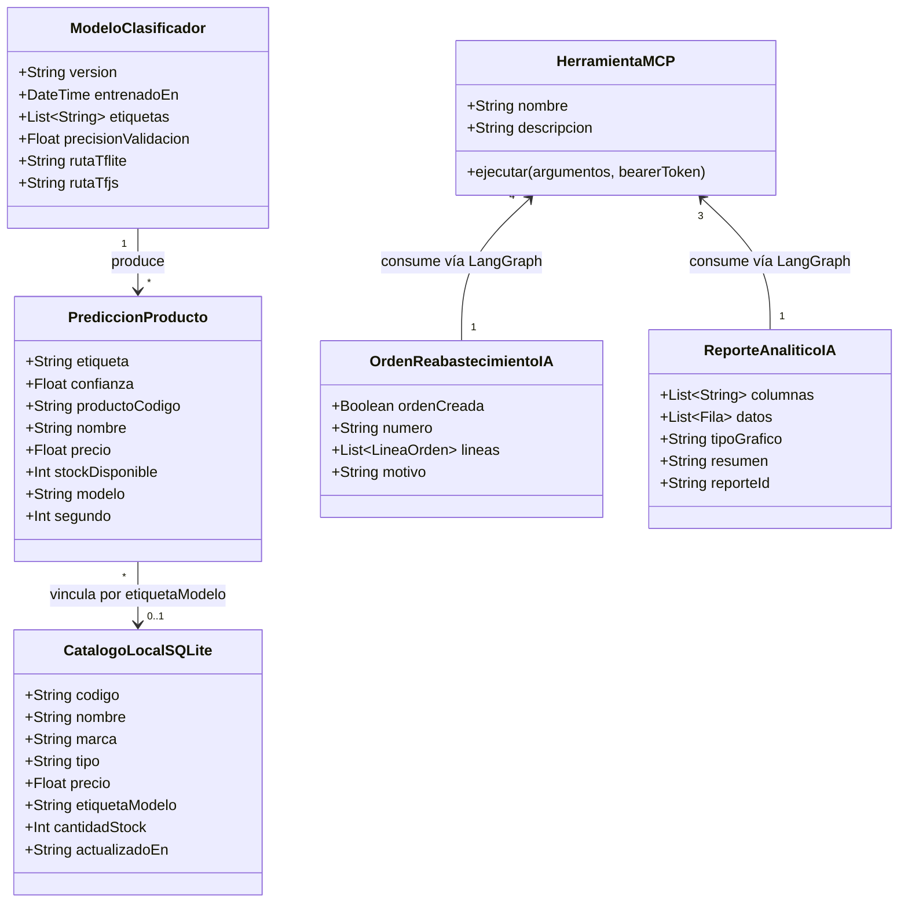
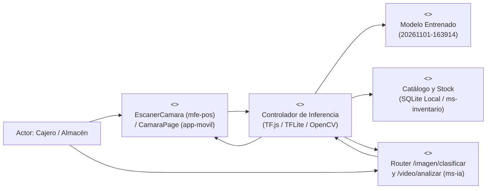
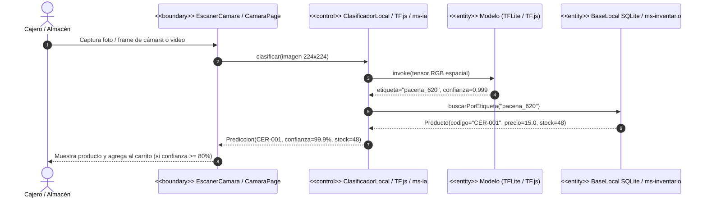
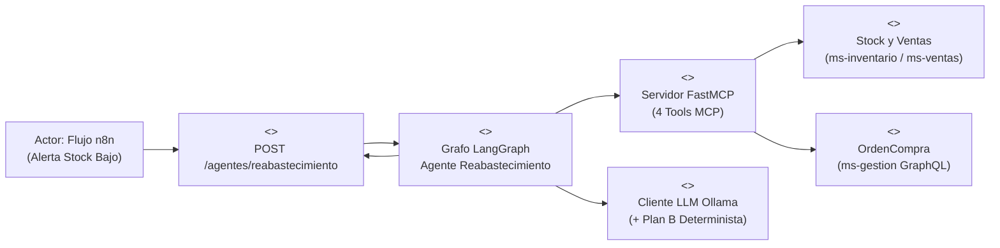
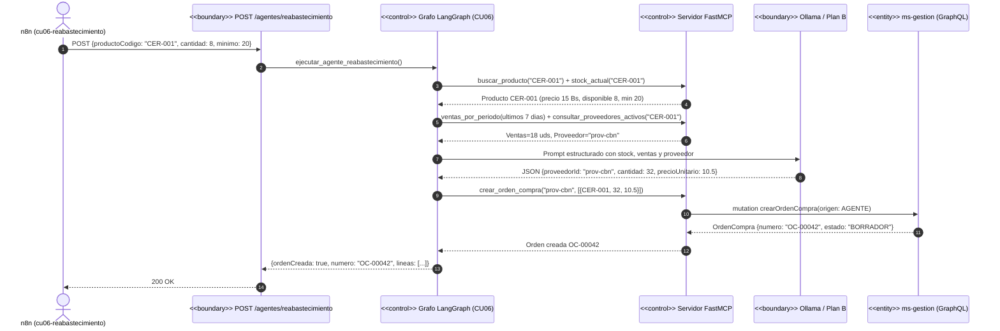
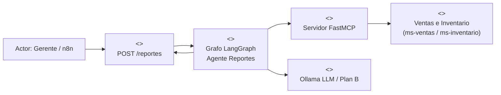
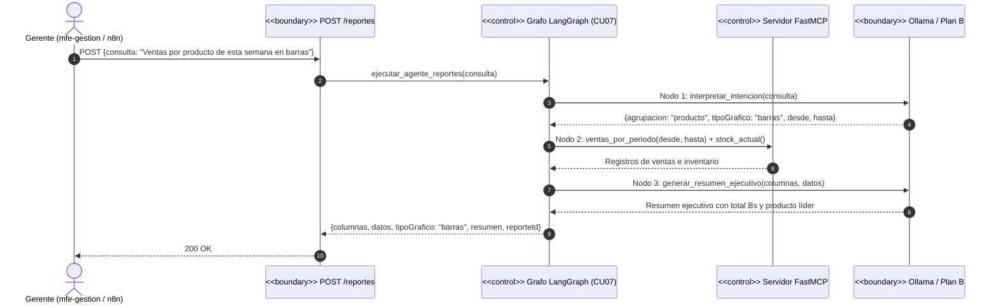

# Modelado ICONIX — DEV 3 (Inteligencia Artificial y Aplicación Móvil)

Este documento contiene los artefactos de la metodología **ICONIX** correspondientes a los tres Casos de Uso bajo responsabilidad de **DEV 3**:
- **CU04:** Reconocer producto por cámara o video (`ms-ia`, `mfe-pos` con TensorFlow.js y `app-movil` con TFLite + SQLite offline).
- **CU06:** Generar orden de compra automática por stock bajo (`n8n` → Agente LangGraph de Reabastecimiento → FastMCP → `ms-gestion`).
- **CU07:** Generar reporte a pedido en lenguaje natural (`mfe-gestion` / `n8n` → Agente LangGraph de Reportes → FastMCP).

---

## 1. Modelo de Dominio (Subdominio IA y Móvil Offline)

---

## 2. Caso de Uso CU04 — Reconocer Producto por Cámara o Video

### 2.1 Especificación del Caso de Uso (Curso Básico y Cursos Alternos)
* **Actores:** Cajero (`mfe-pos`), Encargado de Almacén (`app-movil`), Gerente (`ms-ia`).
* **Precondiciones:** El modelo entrenado (`20261101-163914`) está disponible en `ms-ia/modelos/`, en caché local `localStorage` del navegador (`mfe-pos`) o empaquetado en `assets/modelos/modelo.tflite` (`app-movil`).
* **Curso Normal (Escaneo en POS Web / App Móvil / Video):**
  1. El actor abre el escáner de cámara en `mfe-pos` (`EscanerCamara`) o en `app-movil` (`CamaraPage`), o sube un video a `POST /api/ia/video/analizar`.
  2. La frontera captura la imagen/frame, la redimensiona a `224×224` píxeles y extrae el tensor espacial RGB.
  3. El controlador de inferencia (`clasificadorTfjs` en navegador, `ClasificadorLocal` en Flutter o `Clasificador` + `cv2.VideoCapture` en `ms-ia`) ejecuta la red neuronal y obtiene la etiqueta (`pacena_620`, `huari_620`, `casareal_negra`, `jw_red`, `absolut_750`) y su probabilidad Softmax.
  4. El controlador cruza la etiqueta con el catálogo (`BaseLocal` SQLite en móvil, catálogo del POS en web o `ms-inventario` en backend).
  5. Si la confianza es `>= 80 %`, el sistema muestra el producto reconocido, su código (`CER-001`, etc.), precio y stock, y en el POS lo agrega automáticamente al carrito.
* **Cursos Alternos:**
  * **CA1 (Modo Avión / Sin Conexión en App Móvil y POS Web):** El controlador detecta ausencia de red, utiliza los pesos locales (`MODELO_OFFLINE_POR_DEFECTO` / `assets/modelos/modelo.tflite`) y consulta la tabla `producto JOIN stock` en `BaseLocal` (SQLite) sin realizar llamadas HTTP.
  * **CA2 (Confianza < 80 %):** El sistema informa la clase más cercana pero advierte que la confianza es inferior al umbral del 80 % y no agrega el ítem automáticamente al carrito.
  * **CA3 (Archivo corrupto o vacío):** El controlador devuelve `400 DATOS_INVALIDOS` con mensaje descriptivo.

### 2.2 Diagrama de Robustez — CU04

### 2.3 Diagrama de Secuencia — CU04

---

## 3. Caso de Uso CU06 — Generar Orden de Compra Automática por Stock Bajo

### 3.1 Especificación del Caso de Uso
* **Actor Disparador:** Flujo `n8n` (`cu06-reabastecimiento.json`) activado por webhook desde `ms-inventario` cuando el disponible cae por debajo del mínimo.
* **Curso Normal:**
  1. `n8n` autentica contra Keycloak con credenciales de `gerente01` y envía `POST /api/ia/agentes/reabastecimiento` con `{ productoCodigo, nombre, cantidad, minimo }`.
  2. El grafo de estado **LangGraph** (`reabastecimiento.py`) ejecuta el nodo `recopilar_contexto`, invocando las tools **FastMCP** `buscar_producto`, `stock_actual`, `ventas_por_periodo` (últimos 7 días) y `consultar_proveedores_activos`.
  3. El nodo `decidir_reabastecimiento` consulta a **Ollama** (temperatura `0`) para calcular la cantidad óptima a pedir y el proveedor activo.
  4. El nodo `ejecutar_orden` invoca la tool MCP `crear_orden_compra`, que ejecuta la mutación GraphQL `crearOrdenCompra(origen: AGENTE)` en `ms-gestion`.
  5. Devuelve `{ ordenCreada: true, numero, lineas, motivo }` a `n8n`.
* **Cursos Alternos:**
  * **CA1 (Plan B — Ollama no disponible o respuesta no JSON):** El nodo `decidir_reabastecimiento` aplica automáticamente la regla determinista `max(minimo * 2 - disponible, ventas_7d, 12)` y selecciona el primer proveedor activo del producto.
  * **CA2 (Sin proveedor activo para el producto):** El agente devuelve `{ ordenCreada: false, motivo: "No se encontró un proveedor activo..." }` sin lanzar error 500.

### 3.2 Diagrama de Robustez — CU06

### 3.3 Diagrama de Secuencia — CU06

---

## 4. Caso de Uso CU07 — Generar Reporte a Pedido en Lenguaje Natural

### 4.1 Especificación del Caso de Uso
* **Actores:** Gerente (desde `mfe-gestion`) o flujo programado `n8n` (`cu07-reporte-diario.json`).
* **Curso Normal:**
  1. El actor envía `POST /api/ia/reportes` con `{ consulta, desde?, hasta? }`.
  2. El grafo **LangGraph** (`reportes.py`) ejecuta el nodo `interpretar_intencion` (detecta dimensión de agrupación: por producto, categoría o fecha; y tipo de gráfico: `barras`, `lineas`, `torta`, `tabla`).
  3. El nodo `consultar_datos_mcp` invoca las tools MCP `ventas_por_periodo`, `stock_actual` y `buscar_producto`, construyendo las `columnas` y la matriz `datos`.
  4. El nodo `generar_resumen_ejecutivo` sintetiza el hallazgo principal con Ollama (o resumen ejecutivo determinista en Plan B).
  5. Devuelve `{ columnas, datos, tipoGrafico, resumen, reporteId }`.

### 4.2 Diagrama de Robustez — CU07

### 4.3 Diagrama de Secuencia — CU07

---

## 5. Diagrama de Clases de Diseño (DEV 3: `ms-ia`, `mfe-pos` y `app-movil`)

```mermaid
classDiagram
    class Clasificador_MsIA {
        -_interprete: Interpreter | _InterpreteNumpy
        -_version_cargada: str
        +clasificar(contenido: bytes) Tuple~Prediccion, str~
    }

    class VideoRouter_MsIA {
        +analizar_video(video: UploadFile) List~dict~
        -_extraer_frames_por_segundo(ruta: Path) List~Tuple~int, bytes~~
    }

    class ServidorMCP_MsIA {
        +buscar_producto(texto: str) List~dict~
        +stock_actual(codigo: str) List~dict~
        +ventas_por_periodo(desde: str, hasta: str) List~dict~
        +crear_orden_compra(proveedor_id: str, lineas: list) dict
        +ejecutar_tool(nombre: str, argumentos: dict, token: str) Any
    }

    class AgenteReabastecimiento_MsIA {
        +construir_grafo_reabastecimiento() GrafoCompilado
        +ejecutar_agente_reabastecimiento(codigo, cantidad, minimo, token) dict
    }

    class AgenteReportes_MsIA {
        +construir_grafo_reportes() GrafoCompilado
        +ejecutar_agente_reportes(consulta, desde, hasta, token) dict
    }

    class ClasificadorTfjs_MfePos {
        +obtenerModeloLocal() ModeloTfjsLocal
        +sincronizarModeloLatest() Promise~ModeloTfjsLocal~
        +extraerCaracteristicasRgba(rgba, ancho, alto) number[]
        +clasificarElementoVisual(fuente, catalogo) PrediccionLocal
    }

    class BaseLocal_AppMovil {
        +inicializar() Future~void~
        +listarProductos(busqueda, tipo) List~ProductoConStock~
        +buscarPorEtiqueta(etiqueta) ProductoConStock
        +guardarCatalogoYStock(productos, stocks) Future~void~
    }

    class ClasificadorLocal_AppMovil {
        +inicializar() Future~void~
        +clasificarImagenBytes(bytesImagen) Future~Prediccion~
        +clasificarRgba(rgba, ancho, alto) Prediccion
    }

    VideoRouter_MsIA --> Clasificador_MsIA : clasifica cada 1 s
    AgenteReabastecimiento_MsIA --> ServidorMCP_MsIA : invoca tools MCP
    AgenteReportes_MsIA --> ServidorMCP_MsIA : invoca tools MCP
    ClasificadorLocal_AppMovil --> BaseLocal_AppMovil : cruza etiqueta con SQLite
```

