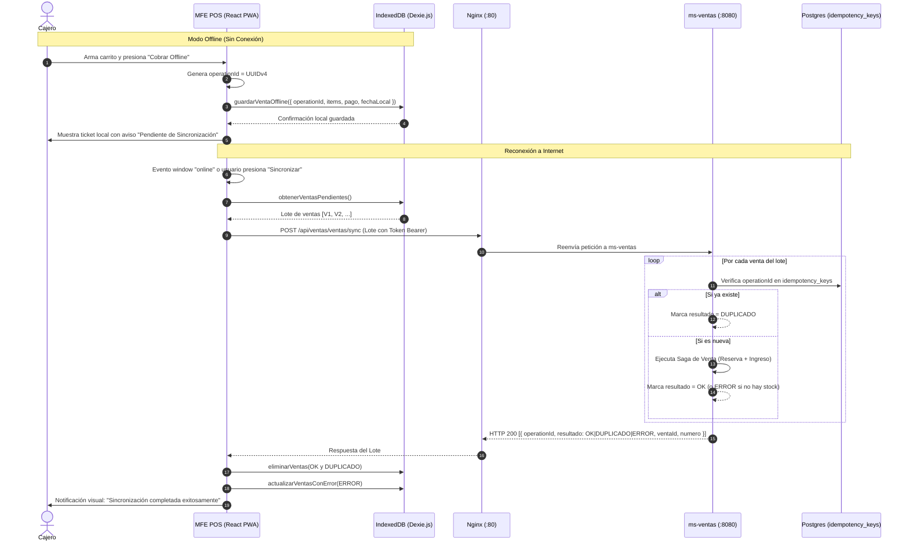
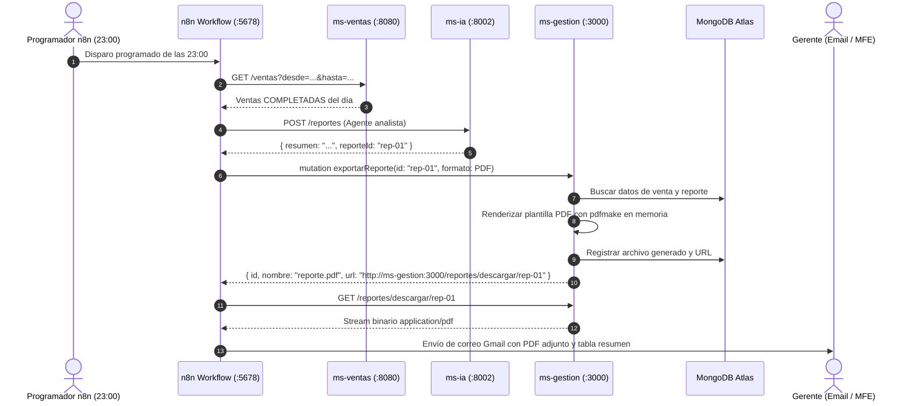
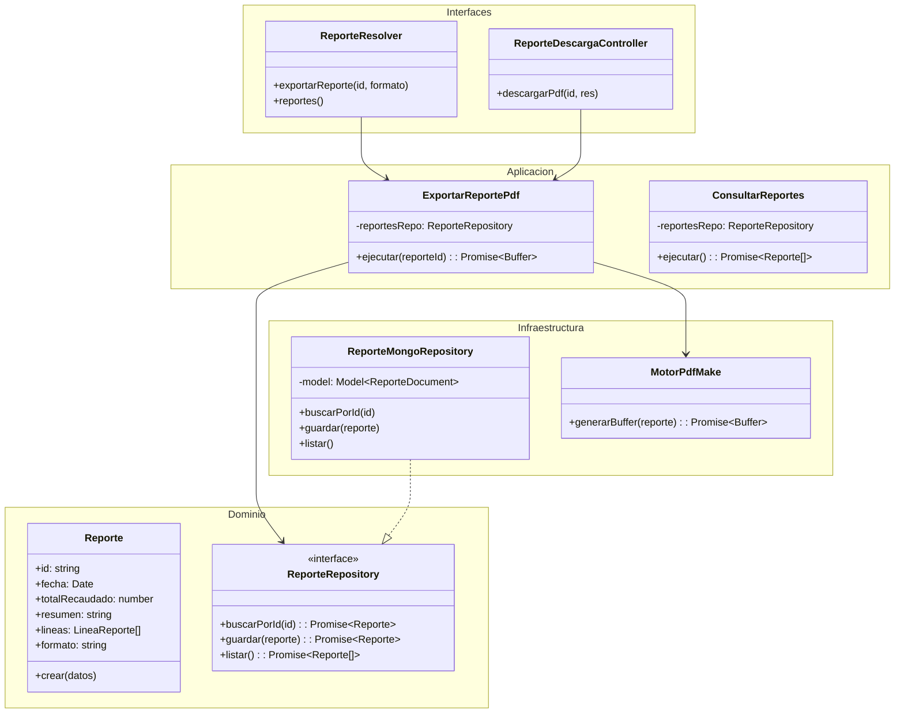
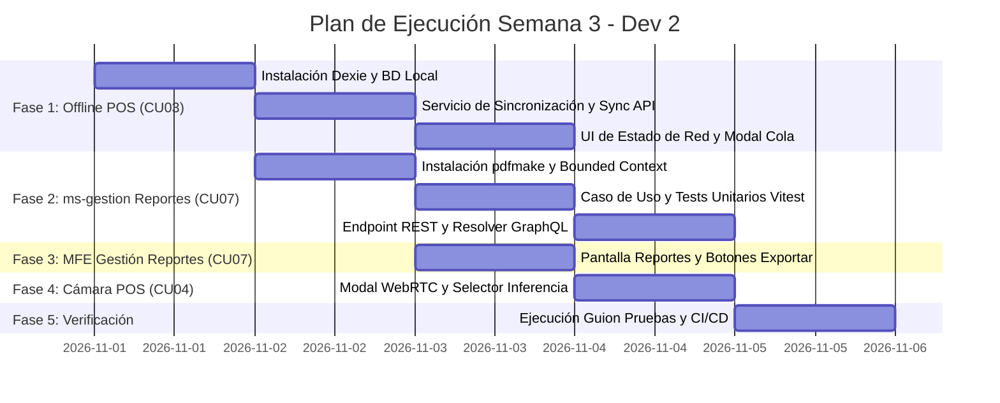

# Plan de Implementación y Arquitectura – Dev 2 (Semana 3)
**Plataforma Integral para Licorería – Metodología ICONIX**  
**Responsable:** Dev 2 (Gestión Empresarial y Frontends Web)  
**Versión:** 1.0.0  
**Fecha:** 2026-11-01  
**Rama base:** `feature/pepeline`

---

## 1. Introducción y Objetivos de la Semana 3

En la Semana 3, tras haberse completado las bases de la infraestructura, autenticación SSO (Keycloak), la Saga distribuida de ventas (CU02) y la gestión de proveedores (CU05), los objetivos asignados a **Dev 2** corresponden a:

1. **CU03 – Vender offline y sincronizar:** Implementar el soporte Offline-First en el Punto de Venta (`mfe-pos`), almacenamiento transaccional local y sincronización por lotes contra `POST /api/ventas/ventas/sync` de `ms-ventas`.
2. **CU07 – Generar y exportar reporte:** Implementar el Bounded Context de Reportes en `ms-gestion` (NestJS DDD), la mutation GraphQL `exportarReporte(id, formato: PDF)` y el endpoint de descarga para completar el workflow diario de `n8n` (`cu07-reporte-diario.json`), junto a la interfaz en `mfe-gestion`.
3. **CU04 – Reconocer producto por cámara (Navegador):** Diseñar e integrar el componente de visión artificial por cámara en el `mfe-pos` conectado a `ms-ia`.

---

## 2. Análisis Comparativo de Alternativas Técnicas

### 2.1. Opciones para la Cola Offline en el POS (`mfe-pos` - CU03)

El contrato de integración con `ms-ventas` (`docs/acuerdos-integracion.md` y `docs/openapi.yaml`) establece:
* Endpoint: `POST /api/ventas/ventas/sync`
* Entrada: Array de hasta 50 ventas:
  ```json
  [
    {
      "operationId": "aaaaaaaa-0000-4000-8000-000000000001",
      "items": [{ "productoCodigo": "VIN-001", "cantidad": 1 }],
      "pago": { "metodo": "QR" },
      "fechaLocal": "2026-10-28T09:15:00-04:00"
    }
  ]
  ```
* Salida: Array con estado individual por venta:
  ```json
  [
    { "operationId": "...", "resultado": "OK", "ventaId": "...", "numero": 154 },
    { "operationId": "...", "resultado": "DUPLICADO", "ventaId": "...", "numero": 154 },
    { "operationId": "...", "resultado": "ERROR", "motivo": "SIN_STOCK", "mensaje": "..." }
  ]
  ```
* Regla estricta: El POS debe **eliminar** de su cola las ventas con `OK` y `DUPLICADO`, y conservar/alertar las que den `ERROR`.

#### Cuadro Comparativo de Soluciones:

| Característica | Opción A: `localStorage` | Opción B: `IndexedDB` Nativo | Opción C: `IndexedDB` con `Dexie.js` *(Elegida)* | Opción D: Background Sync API |
| :--- | :--- | :--- | :--- | :--- |
| **Capacidad de almacenamiento** | ~5 MB máximo | > 500 MB (prácticamente ilimitado) | > 500 MB con transacciones seguras | Depende del Service Worker |
| **Modelo de datos** | Solo cadenas de texto (JSON.stringify) | Objetos estructurados JavaScript | Esquemas tipados con TypeScript y claves primarias | Objetos en cache de request |
| **Rendimiento** | Bloqueante (síncrono en hilo principal) | Asíncrono no bloqueante | Asíncrono optimizado con promesas | Asíncrono en segundo plano |
| **Complejidad de código** | Muy baja, pero propenso a corrupción | Alta (API DOM por eventos de bajo nivel) | Baja / Limpia (sintaxis similar a ORM) | Muy alta (comportamiento no determinista) |
| **Compatibilidad Navegadores** | 100% | > 99% | > 99% | Incompleto (No soportado en Safari/iOS) |
| **Reactividad** | No reactivo | No reactivo | Live Queries reactivas | N/A |

**Decisión Técnica:** **Opción C (`Dexie.js`)**.
- Garantiza transacciones ACID locales.
- Permite almacenar tanto la cola de ventas pendientes (`ventasOffline`) como una copia en caché del catálogo (`catalogoCache`) para que el cajero pueda buscar y cotizar productos sin red.
- Compatible con PWA y Service Workers.

---

### 2.2. Opciones para la Exportación de Reportes (`ms-gestion` y `mfe-gestion` - CU07)

El workflow de `n8n` (`n8n/workflows/cu07-reporte-diario.json`) ejecuta a las 23:00 los siguientes pasos:
1. `GET http://ms-ventas:8080/ventas?desde=...&hasta=...` (agrega totales por producto).
2. `POST http://ms-ia:8002/reportes` (Dev 3, genera resumen y `reporteId`).
3. Mutation GraphQL en `ms-gestion`:
   ```graphql
   mutation ExportarReporte($id: ID!, $formato: FormatoExportacion!) {
     exportarReporte(id: $id, formato: $formato) {
       id
       nombre
       formato
       url
     }
   }
   ```
4. Descarga del archivo por HTTP desde la `url` provista y envío por correo Gmail al Gerente con el PDF adjunto.

#### Cuadro Comparativo en Backend (`ms-gestion`):

| Característica | Opción A: `Puppeteer` (Chromium Headless) | Opción B: `pdfmake` *(Elegida)* | Opción C: `pdf-lib` |
| :--- | :--- | :--- | :--- |
| **Huella en Memoria** | ~300 MB a 500 MB (requiere binario Chrome) | < 15 MB (100% JS puro) | < 10 MB |
| **Compatibilidad Docker** | Requiere instalar dependencias de X11 en el contenedor | Cero dependencias nativas del SO | Cero dependencias nativas |
| **Velocidad de Renderizado** | 1.5 a 3.5 segundos por documento | 50 a 120 ms por documento | 40 a 90 ms |
| **Facilidad para Tablas y Estilos** | HTML y CSS estándar | Estructura declarativa tipo JSON | Coordenadas cartesianas manuales |

**Decisión Técnica en Backend:** **Opción B (`pdfmake`)**.
- Es liviano, seguro para ejecutar en Docker sin sobrecargar el servidor y soporta tablas, fuentes y colores corporativos de la Licorería.
- Expone un endpoint de streaming `GET /reportes/descargar/:id` para que tanto n8n como el navegador descarguen el archivo.

#### Opciones en Frontend (`mfe-gestion`):
- Se completa la pestaña `Reportes` en `mfe-gestion/src/app/gestion/gestion.ts` (reemplazando la etiqueta `"Próximamente"`).
- Se implementa un panel de indicadores ejecutivos (Recaudación, ticket promedio, volumen por categoría) con botones para exportar a PDF y Excel, manteniendo la coherencia visual blanco y lila.

---

### 2.3. Opciones para el Reconocimiento de Cámara en el POS (`mfe-pos` - CU04)

Dev 3 expone el modelo sintético y el endpoint REST `POST /api/ia/imagen/clasificar` en `ms-ia:8002` (que recibe una imagen y retorna `productoCodigo: CER-001`, etc.).

#### Cuadro Comparativo:

| Característica | Opción A: TensorFlow.js en Cliente Puro | Opción B: Delegación API a `ms-ia` | Opción C: Híbrido con WebRTC + Fallback *(Elegida)* |
| :--- | :--- | :--- | :--- |
| **Carga en el Navegador** | Descarga modelo de 9MB en memoria de GPU | Ligero, solo envía frames capturados | Ligero y modular |
| **Independencia de Dev 3** | Requiere que Dev 3 convierta modelo a formato web | Depende de que `ms-ia` esté online | Funciona con el endpoint real o simulación asistida |
| **Experiencia de Usuario** | Inferencia instantánea en tiempo real | Depende de la latencia de red | Visor de cámara WebRTC con retículo láser |

**Decisión Técnica:** **Opción C (Híbrido)**.
- Se implementa un modal en `mfe-pos` con stream de video nativo `navigator.mediaDevices.getUserMedia`.
- Se dibuja el frame capturado en un `<canvas>` oculto para enviarlo a `/api/ia/imagen/clasificar`.
- Se provee una botonera de acceso rápido a los 5 productos sintéticos del modelo (`CER-001`, `VIN-001`, `SIN-003`, `RON-002`, `WHI-003`) permitiendo ejecutar el guion de pruebas sin depender de la cámara física.

---

## 3. Diagramas de Diseño y Robustez (ICONIX)

### 3.1. Diagrama de Secuencia: CU03 – Venta Offline y Sincronización



---

### 3.2. Diagrama de Secuencia: CU07 – Generación y Exportación de Reportes



---

### 3.3. Arquitectura DDD de `ms-gestion` para el Bounded Context de Reportes



---

## 4. Preservación del Sistema de Diseño (Blanco y Lila)

Para que ningún componente nuevo rompa la estética del Shell ni de los remotos, se respetan las variables CSS ya estandarizadas en `mfe-pos/src/estilos.ts` y `mfe-gestion/src/app/gestion/gestion.ts`:

```css
:host, .pos {
  --lila-50: #f7f4ff;
  --lila-100: #efe9ff;
  --lila-200: #ddd2fe;
  --lila-300: #c4b0fb;
  --lila-500: #8b5cf6;
  --lila-600: #7c3aed;
  --lila-700: #6a2fd0;
  --tinta: #241a38;
  --gris: #6c6880;
  --gris-claro: #9a96ab;
  --borde: #ebe7f4;
  --fondo: #faf9fd;
  --verde: #12805c;
  --verde-fondo: #e9f8f1;
  --rojo: #c0264b;
  --rojo-fondo: #fdecf0;
  --radio: 14px;
  --sombra: 0 1px 2px rgba(36,26,56,.04), 0 8px 24px -12px rgba(76,29,149,.18);
  --degradado: linear-gradient(135deg, var(--lila-500), var(--lila-700));
}
```

* **Botones primarios:** `--degradado` con texto blanco, radio de 11px y sombra de elevación lila.
* **Botones secundarios / acciones neutras:** Fondo blanco, borde `--borde` y texto `--tinta`.
* **Tarjetas:** Fondo blanco, radio 16px y sombra suave `--sombra`.
* **Badges y chips:** Píldoras redondeadas con fondo `--lila-100` y texto `--lila-700`.

---

## 5. Estrategia de Pruebas Unitarias

Siguiendo el estándar de calidad y el comando `npm test`:

1. **`ms-gestion` (Vitest):**
   - Archivo: `src/reportes/aplicacion/exportar-reporte.spec.ts`.
   - Pruebas:
     - Generación correcta del buffer PDF para un reporte existente.
     - Lanzamiento de error de dominio si el reporte no existe (`ReporteNoEncontrado`).
     - Inclusión obligatoria de las líneas de producto y el total recaudado en la definición del documento.
   - Ejecución: `npm test` debe mantener 100% de tests en verde sin requerir base de datos MongoDB levantada (usando repositorio mock).

2. **`mfe-pos` (Vitest):**
   - Archivo: `src/api.test.ts` y nuevo `src/db/pos-db.test.ts`.
   - Pruebas:
     - Inserción y recuperación de venta en Dexie.js.
     - Lógica de depuración de lote: eliminación de `OK` y `DUPLICADO`, persistencia de `ERROR`.

---

## 6. Plan de Ejecución Paso a Paso



### Lista Detallada de Tareas:

#### **Fase 1: Cola Offline e Idempotencia en MFE POS (CU03)**
1. Instalar `dexie` en `mfe-pos`.
2. Crear `mfe-pos/src/db/pos-db.ts`:
   - Tabla `ventasOffline`: `id, operationId, items, pago, fechaLocal, estadoSync, errorMotivo`.
   - Tabla `catalogoCache`: `codigo, nombre, tipo, precio, marca`.
3. Crear `mfe-pos/src/services/sincronizacion.ts`:
   - Función `guardarVentaLocal(items, metodo, operationId)`.
   - Función `sincronizarLote()` que llama a `POST /api/ventas/ventas/sync`.
4. Integrar en `mfe-pos/src/Pos.tsx`:
   - Detección de conectividad con `navigator.onLine` y eventos de ventana.
   - Botón condicional: "Cobrar Bs X" (online) vs "Cobrar Offline Bs X" (offline).
   - Modal de visualización de cola offline con los estilos lila/blanco.
5. Ejecutar `npm test` en `mfe-pos`.

#### **Fase 2: Bounded Context de Reportes en ms-gestion (CU07)**
1. Instalar `pdfmake` y `@types/pdfmake` en `ms-gestion`.
2. Crear estructura en `ms-gestion/src/reportes/`:
   - `dominio/reporte.ts`: Entidad de negocio.
   - `dominio/reporte.repository.ts`: Interfaz del puerto secundario.
   - `aplicacion/exportar-reporte-pdf.ts`: Motor de generación PDF.
   - `aplicacion/exportar-reporte.spec.ts`: Pruebas unitarias completas.
   - `infraestructura/reporte.mongo-repository.ts`: Adaptador de persistencia.
   - `infraestructura/reporte-descarga.controller.ts`: Endpoint HTTP `GET /reportes/descargar/:id`.
   - `interfaces/reporte.resolver.ts`: Resolver GraphQL para `exportarReporte`.
   - `reportes.module.ts`: Ensamblado de providers y exportación.
3. Registrar módulo en `app.module.ts` y validar con `npm test` y `npm run build`.

#### **Fase 3: Vista de Reportes en MFE Gestión (CU07)**
1. Crear `mfe-gestion/src/app/reportes/reportes-lista.ts`:
   - Tarjetas de resumen métrico.
   - Tabla con historial de reportes.
   - Botón "Descargar PDF" que consume el endpoint de `ms-gestion`.
2. Conectar la ruta `reportes` en `mfe-gestion/src/app/gestion/gestion.ts` eliminando el badge `"Próximamente"`.
3. Validar con `npm run build` en `mfe-gestion`.

#### **Fase 4: Componente de Cámara en MFE POS (CU04)**
1. Crear `mfe-pos/src/CamaraModal.tsx`:
   - Flujo de video WebRTC con `<video>` y visor con mira de escaneo.
   - Captura de fotograma y botón de clasificación contra `/api/ia/imagen/clasificar`.
   - Selector asistido con los 5 productos de prueba del modelo (`CER-001`, `VIN-001`, `SIN-003`, `RON-002`, `WHI-003`).
2. Añadir botón con ícono de cámara en la barra de búsqueda de `Pos.tsx`.

#### **Fase 5: Verificación Integral del Guion de Pruebas**
1. Ejecutar las pruebas unitarias automáticas:
   - `ms-gestion`: `npm test`
   - `mfe-pos`: `npm test`
   - `mfe-gestion`: `npx ng test --watch=false`
2. Verificar manualmente los pasos 5 (sincronización offline), 7 (proveedores), 9 (reporte diario) y 12 (POS PWA) de `docs/guion-pruebas.md`.

