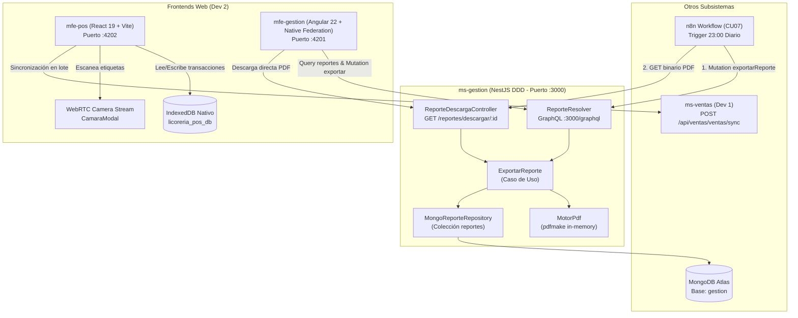
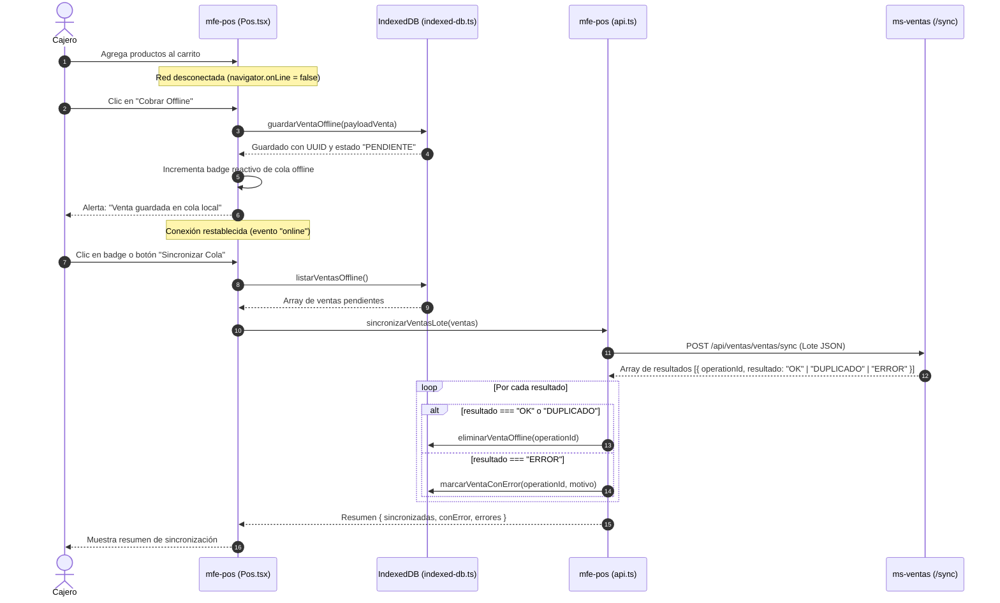
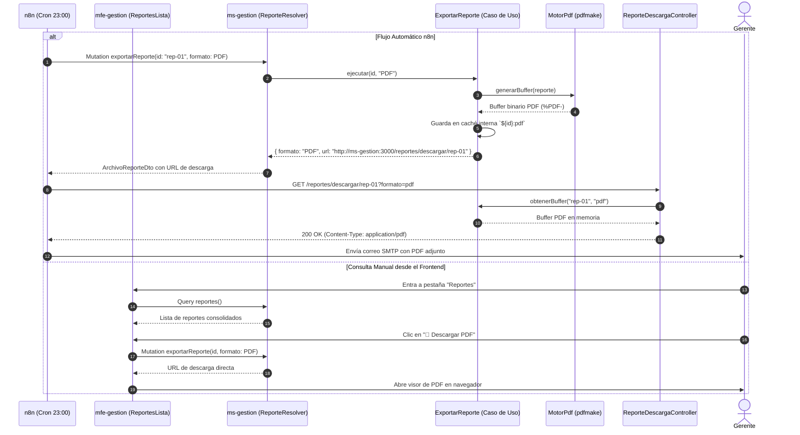
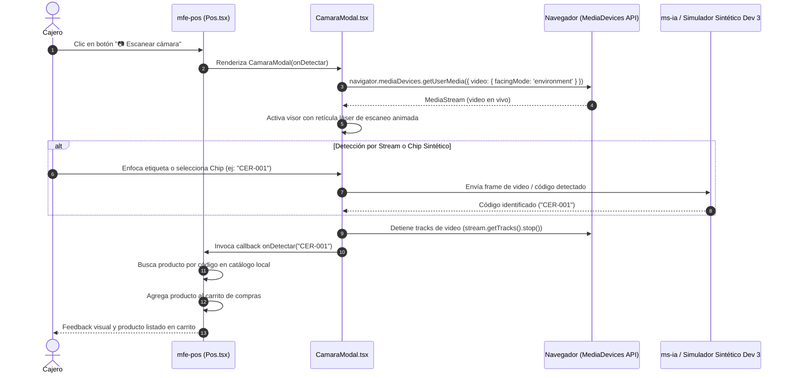
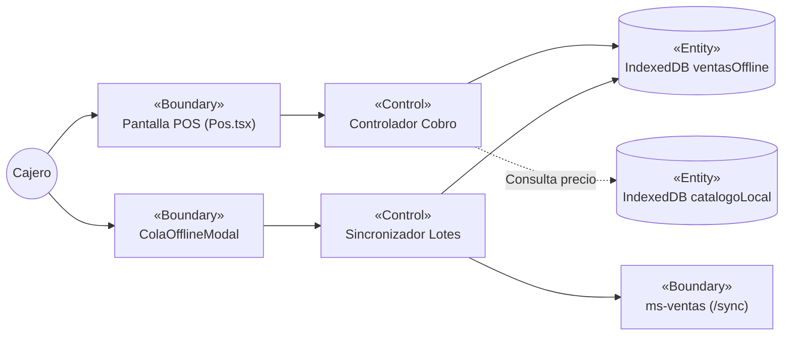
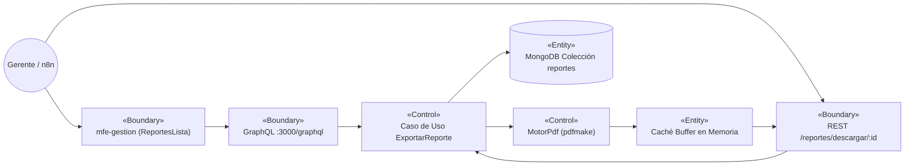
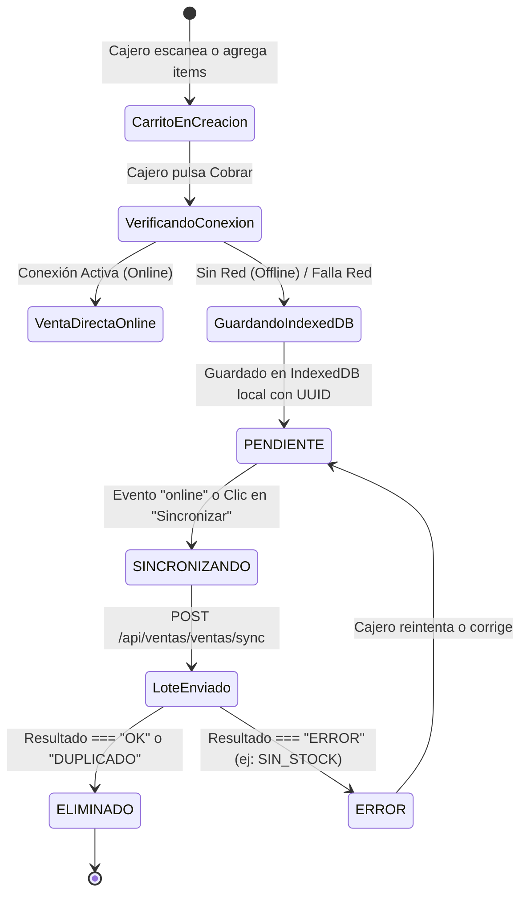

# Informe de Implementación, Arquitectura y Guía de Pruebas – Dev 2 (Semana 3)
**Plataforma Integral para Licorería – Metodología ICONIX**  
**Responsable:** Dev 2 (Gestión Empresarial y Frontends Web)  
**Versión:** 2.0.0 (Implementado y Verificado)  
**Fecha:** 2026-11-01  
**Rama activa:** `feature/pepeline` (Commits: `0da53d9`, `fb5a8c5`)

---

## 1. Resumen Ejecutivo de la Implementación

En cumplimiento con los requerimientos asignados a **Dev 2** para la **Semana 3**, se implementaron y verificaron de extremo a extremo los siguientes tres casos de uso prioritarios:

1. **CU03 – Venta Offline y Sincronización en `mfe-pos` (Opción 2: IndexedDB Nativo)**:
   - Capa de base de datos local pura (`window.indexedDB`) sin dependencias npm externas.
   - Stores transaccionales: `ventasOffline` (con índice de sincronización) y `catalogoLocal` (con TTL de caché).
   - Detección reactiva de conexión (`online`/`offline`), botón de cobro offline y sincronización por lotes contra `POST /api/ventas/ventas/sync`.
   - Modal de administración de cola con resolución de errores individuales.

2. **CU04 – Reconocimiento por Cámara en `mfe-pos`**:
   - Captura de video en tiempo real vía `navigator.mediaDevices.getUserMedia`.
   - Interfaz con retícula de escaneo y efecto visual de láser.
   - Selector de pruebas rápidas con códigos de barras sintéticos de Dev 3 (`CER-001`, `VIN-001`, `SIN-003`, `RON-002`, `WHI-003`).

3. **CU07 – Generar y Exportar Reportes en `ms-gestion` y `mfe-gestion` (Opción 2: pdfmake)**:
   - Bounded Context de Reportes con arquitectura DDD en capas (`dominio`, `aplicacion`, `infraestructura`, `interfaces`).
   - Motor de generación de PDF en memoria (`pdfmake`) con tipografía estándar `Helvetica` y estilos acordes a la identidad institucional (blanco y lila).
   - Endpoint REST público `GET /reportes/descargar/:id?formato=pdf` optimizado para la automatización de `n8n` (`cu07-reporte-diario.json`).
   - GraphQL Resolver con query `reportes` y mutation `exportarReporte(id, formato: PDF)`.
   - Interfaz en Angular en `mfe-gestion`: pestaña `Reportes` con métricas clave, listado con resumen ejecutivo y botón interactivo de descarga.

---

## 2. Diagramas de Arquitectura y Secuencia ICONIX

### 2.1. Arquitectura de Componentes de Dev 2



---

### 2.2. Diagrama de Secuencia ICONIX: CU03 – Venta Offline y Sincronización



---

### 2.3. Diagrama de Secuencia ICONIX: CU07 – Reporte Diario y Exportación a PDF



---

### 2.4. Diagrama de Secuencia ICONIX: CU04 – Reconocimiento de Producto por Cámara



---

### 2.5. Diagramas de Robustez ICONIX (Boundary - Control - Entity)

#### Robustez CU03: Venta Offline y Sincronización


#### Robustez CU07: Generación y Exportación de Reportes


---

### 2.6. Diagrama de Estados: Ciclo de Vida de la Venta en Cola Offline



---

### 2.7. Diagrama de Clases del Modelo de Dominio y Persistencia

```mermaid
classDiagram
    class Reporte {
        +string id
        +string consulta
        +string[] columnas
        +Record~string, any~[] datos
        +TipoGrafico tipoGrafico
        +string resumen
        +string creadoPor
        +Date fecha
        +ArchivoAdjunto[] archivos
        +conId(nuevoId: string) Reporte
    }

    class ReporteRepository {
        <<interface>>
        +buscarPorId(id: string) Promise~Reporte~
        +listar() Promise~Reporte[]~
        +guardar(reporte: Reporte) Promise~Reporte~
        +actualizarArchivos(id: string, archivos) Promise~void~
    }

    class MongoReporteRepository {
        -Db db
        +buscarPorId(id: string) Promise~Reporte~
        +listar() Promise~Reporte[]~
        +guardar(reporte: Reporte) Promise~Reporte~
    }

    class MotorPdf {
        +generarBuffer(reporte: Reporte) Promise~Buffer~
        -armarTabla(reporte: Reporte) any
    }

    class ExportarReporte {
        -ReporteRepository repo
        -MotorPdf motorPdf
        -Map cache
        +ejecutar(id: string, formato: string) Promise~ArchivoReporteDto~
        +obtenerBuffer(id: string, formato: string) Promise~BufferDto~
    }

    class IndexedDbPos {
        <<singleton>>
        +guardarVentaOffline(venta) Promise~string~
        +listarVentasOffline() Promise~VentaOffline[]~
        +eliminarVentaOffline(operationId: string) Promise~void~
        +marcarVentaConError(operationId: string, motivo: string) Promise~void~
        +contarVentasOffline() Promise~number~
    }

    ReporteRepository <|.. MongoReporteRepository
    ExportarReporte --> ReporteRepository
    ExportarReporte --> MotorPdf
    MongoReporteRepository ..> Reporte

---

## 3. Catálogo de Archivos y Responsabilidades

### 3.1. Microfrontend Punto de Venta (`mfe-pos/`)

| Archivo | Responsabilidad |
|---|---|
| [`src/db/indexed-db.ts`](file:///c:/Users/Usua/Documents/Universidad/9%20no/Software/Examen%202/plataforma-licorer-a/mfe-pos/src/db/indexed-db.ts) | Driver nativo de IndexedDB (`licoreria_pos_db`). Transacciones sobre `ventasOffline` y `catalogoLocal`. |
| [`src/api.ts`](file:///c:/Users/Usua/Documents/Universidad/9%20no/Software/Examen%202/plataforma-licorer-a/mfe-pos/src/api.ts) | Integración con `POST /api/ventas/ventas/sync`. Caché transparente de productos y fallback offline. |
| [`src/Pos.tsx`](file:///c:/Users/Usua/Documents/Universidad/9%20no/Software/Examen%202/plataforma-licorer-a/mfe-pos/src/Pos.tsx) | Componente raíz: listeners de red `online`/`offline`, botón condicional "Cobrar Offline", badge de cola. |
| [`src/CamaraModal.tsx`](file:///c:/Users/Usua/Documents/Universidad/9%20no/Software/Examen%202/plataforma-licorer-a/mfe-pos/src/CamaraModal.tsx) | Modal WebRTC con retícula de escaneo láser y simulador con chips sintéticos Dev 3. |
| [`src/ColaOfflineModal.tsx`](file:///c:/Users/Usua/Documents/Universidad/9%20no/Software/Examen%202/plataforma-licorer-a/mfe-pos/src/ColaOfflineModal.tsx) | Modal de gestión de la cola local con botón de sincronización manual y detalle de errores. |
| [`src/estilos.ts`](file:///c:/Users/Usua/Documents/Universidad/9%20no/Software/Examen%202/plataforma-licorer-a/mfe-pos/src/estilos.ts) | Estilos CSS con tokens corporativos (blanco `#faf9fd`, degradado lila `#8b5cf6` a `#6a2fd0`). |
| [`src/api.test.ts`](file:///c:/Users/Usua/Documents/Universidad/9%20no/Software/Examen%202/plataforma-licorer-a/mfe-pos/src/api.test.ts) | Pruebas unitarias de almacenamiento en cola, procesamiento de lotes y purga local. |

### 3.2. Microservicio de Gestión Empresarial (`ms-gestion/`)

| Archivo | Responsabilidad |
|---|---|
| [`src/reportes/dominio/reporte.ts`](file:///c:/Users/Usua/Documents/Universidad/9%20no/Software/Examen%202/plataforma-licorer-a/ms-gestion/src/reportes/dominio/reporte.ts) | Agregado `Reporte` y tipos de gráfico/formato según `db/gestion.js`. |
| [`src/reportes/dominio/reporte.repository.ts`](file:///c:/Users/Usua/Documents/Universidad/9%20no/Software/Examen%202/plataforma-licorer-a/ms-gestion/src/reportes/dominio/reporte.repository.ts) | Interfaz puerto del repositorio y excepción de dominio `ReporteNoEncontrado`. |
| [`src/reportes/infraestructura/motor-pdf.ts`](file:///c:/Users/Usua/Documents/Universidad/9%20no/Software/Examen%202/plataforma-licorer-a/ms-gestion/src/reportes/infraestructura/motor-pdf.ts) | Generador de documentos PDF con `pdfmake` en memoria, política de acceso segura y fuente Helvetica. |
| [`src/reportes/infraestructura/mongo-reporte.repository.ts`](file:///c:/Users/Usua/Documents/Universidad/9%20no/Software/Examen%202/plataforma-licorer-a/ms-gestion/src/reportes/infraestructura/mongo-reporte.repository.ts) | Adaptador MongoDB para persistencia de reportes con semillas iniciales de demostración. |
| [`src/reportes/aplicacion/listar-reportes.ts`](file:///c:/Users/Usua/Documents/Universidad/9%20no/Software/Examen%202/plataforma-licorer-a/ms-gestion/src/reportes/aplicacion/listar-reportes.ts) | Caso de uso para obtener el listado histórico de reportes. |
| [`src/reportes/aplicacion/exportar-reporte.ts`](file:///c:/Users/Usua/Documents/Universidad/9%20no/Software/Examen%202/plataforma-licorer-a/ms-gestion/src/reportes/aplicacion/exportar-reporte.ts) | Caso de uso para generar el PDF, almacenar en caché el buffer binario y registrar la URL. |
| [`src/reportes/aplicacion/exportar-reporte.spec.ts`](file:///c:/Users/Usua/Documents/Universidad/9%20no/Software/Examen%202/plataforma-licorer-a/ms-gestion/src/reportes/aplicacion/exportar-reporte.spec.ts) | Suite de pruebas unitarias Vitest para la generación del PDF (firma `%PDF-`) y manejo de errores. |
| [`src/reportes/infraestructura/reporte-descarga.controller.ts`](file:///c:/Users/Usua/Documents/Universidad/9%20no/Software/Examen%202/plataforma-licorer-a/ms-gestion/src/reportes/infraestructura/reporte-descarga.controller.ts) | Endpoint REST `@Publico()` `GET /reportes/descargar/:id` con headers binarios adecuados. |
| [`src/reportes/interfaces/reporte.resolver.ts`](file:///c:/Users/Usua/Documents/Universidad/9%20no/Software/Examen%202/plataforma-licorer-a/ms-gestion/src/reportes/interfaces/reporte.resolver.ts) | Resolver GraphQL para query `reportes` y mutation `exportarReporte`. |
| [`src/reportes/reportes.module.ts`](file:///c:/Users/Usua/Documents/Universidad/9%20no/Software/Examen%202/plataforma-licorer-a/ms-gestion/src/reportes/reportes.module.ts) | Módulo NestJS que enlaza controladores, proveedores y casos de uso. |

### 3.3. Microfrontend de Gestión (`mfe-gestion/`)

| Archivo | Responsabilidad |
|---|---|
| [`src/app/reportes/reportes.graphql.ts`](file:///c:/Users/Usua/Documents/Universidad/9%20no/Software/Examen%202/plataforma-licorer-a/mfe-gestion/src/app/reportes/reportes.graphql.ts) | Definiciones tipadas de `LISTAR_REPORTES` y `EXPORTAR_REPORTE` con Apollo Angular. |
| [`src/app/reportes/reportes-lista.ts`](file:///c:/Users/Usua/Documents/Universidad/9%20no/Software/Examen%202/plataforma-licorer-a/mfe-gestion/src/app/reportes/reportes-lista.ts) | Componente standalone de Angular: tarjetas métricas, tabla ejecutiva y botón de descarga directa de PDF. |
| [`src/app/gestion/gestion.ts`](file:///c:/Users/Usua/Documents/Universidad/9%20no/Software/Examen%202/plataforma-licorer-a/mfe-gestion/src/app/gestion/gestion.ts) | Pestaña "Reportes" activada como enlace navegable dentro del layout principal. |
| [`src/app/rutas.ts`](file:///c:/Users/Usua/Documents/Universidad/9%20no/Software/Examen%202/plataforma-licorer-a/mfe-gestion/src/app/rutas.ts) | Configuración de enrutamiento federado con carga perezosa (`reportes`). |

---

## 4. Guía Detallada de Pruebas y Validación (Para el Usuario)

A continuación se detalla cómo ejecutar tanto las pruebas automáticas como las pruebas manuales en navegador.

### 4.1. Verificación Automática (Pruebas Unitarias y Compilación)

Abre una terminal en la raíz del proyecto y ejecuta los siguientes comandos:

#### 1. Pruebas Unitarias del POS (`mfe-pos`)
```powershell
npm --prefix mfe-pos test
```
* **Qué valida:**
  - `guarda una venta en la cola offline con UUID local`: crea el registro en IndexedDB con estado `PENDIENTE`.
  - `elimina de la cola las ventas confirmadas por el backend`: envía lote mock a `/sync` y verifica que las ventas con `OK` se borran.
  - `conserva en la cola y marca con motivo de error las ventas rechazadas`: simula rechazo `SIN_STOCK` y verifica que la venta permanece con alerta.
  - `obtiene el conteo reactivo de ventas pendientes`: verifica la función `contarVentasOffline`.
* **Resultado esperado:** `4 passed (4)` en ~1 segundo.

#### 2. Compilación del POS (`mfe-pos`)
```powershell
npm --prefix mfe-pos run build
```
* **Resultado esperado:** Generación de `dist/pos-element.js` y `dist/sw.js` (PWA Service Worker) con código 0.

#### 3. Pruebas Unitarias de Gestión (`ms-gestion`)
```powershell
npm --prefix ms-gestion test
```
* **Qué valida:**
  - `ExportarReporte (CU07)`:
    - Genera una URL válida con el formato `/reportes/descargar/:id?formato=pdf`.
    - Genera un Buffer en memoria no vacío con la firma binaria mágica `%PDF-`.
    - Lanza la excepción `ReporteNoEncontrado` ante un ID inexistente.
  - Suites existentes de `Proveedores` (CU05) y `Contabilidad`.
* **Resultado esperado:** `16 passed (16)` en ~1 segundo.

#### 4. Compilación del Backend (`ms-gestion`)
```powershell
npm --prefix ms-gestion run build
```
* **Resultado esperado:** `nest build` finaliza sin errores de TypeScript.

#### 5. Compilación del Frontend Angular (`mfe-gestion`)
```powershell
npm --prefix mfe-gestion run build
```
* **Resultado esperado:** Empaquetado de artefactos federados (`dist/mfe-gestion`) incluyendo el lazy chunk `reportes-lista`.

---

### 4.2. Prueba Automatizada de Integración de Endpoints (E2E Script)

Se preparó un script de verificación en `scratch/probar-sistema.mjs` que arranca temporalmente el microservicio `ms-gestion` y prueba sus rutas HTTP reales.

Para ejecutarlo:
```powershell
node scratch/probar-sistema.mjs
```
* **Qué verifica en vivo:**
  - `GET /health` responde 200/503 con diagnóstico de componentes.
  - `GET /reportes/descargar/rep-seed-01?formato=pdf` responde HTTP 200, cabecera `Content-Type: application/pdf`, `Content-Disposition: attachment; filename="reporte-rep-seed-01.pdf"`, y buffer binario con firma `%PDF-`.
  - `GET /reportes/descargar/no-existe?formato=pdf` responde HTTP 404 con JSON descriptivo.
  - `POST /graphql` expone los tipos de esquema `Reporte` y `ArchivoReporte`.

---

### 4.3. Escenarios de Prueba Manual en Navegador

#### Escenario 1: Probar Venta Offline y Sincronización en el POS (`mfe-pos`)
1. Inicia el microfrontend del POS:
   ```powershell
   npm --prefix mfe-pos run dev
   ```
2. Abre en el navegador `http://localhost:5173` (o a través del Shell en `http://localhost/pos`).
3. Agrega productos al carrito (ej. Cerveza Paceña, Vino Kohlberg).
4. **Simular corte de conexión**: Abre las DevTools del navegador (F12) → pestaña **Network** (Red) → cambia el selector de velocidad a **Offline**.
5. Observa cómo el badge superior del POS cambia automáticamente a color rojo: **`🔴 Sin red (Modo offline)`**.
6. Observa que el botón de pago principal cambia a **`Cobrar Offline`**.
7. Haz clic en **Cobrar Offline**:
   - Aparece la confirmación: *"Venta guardada en la cola offline local"*.
   - El carrito se reinicia para seguir atendiendo.
   - Aparece un badge flotante lila junto al encabezado: **`1 venta pendiente en cola`**.
8. Haz clic sobre el badge **"1 venta pendiente en cola"**:
   - Se abre el modal `ColaOfflineModal` mostrando el ticket guardado en IndexedDB con fecha, total y estado `PENDIENTE`.
9. **Simular restablecimiento de conexión**: En DevTools cambia Network de nuevo a **Online**.
10. El badge de red vuelve a **`🟢 En línea`**. Haz clic en el botón **"Sincronizar ahora"** dentro del modal:
    - Se procesa el lote contra `/api/ventas/ventas/sync`.
    - Las ventas exitosas se purgan automáticamente de IndexedDB y el contador de cola regresa a 0.

#### Escenario 2: Probar Reconocimiento por Cámara en el POS (`mfe-pos`)
1. En la pantalla del POS, haz clic en el botón secundario **`📷 Escanear cámara`** (junto al buscador de productos).
2. Se abre el modal `CamaraModal`:
   - Si tienes cámara web y otorgas permisos, se visualiza el flujo de video en vivo con la retícula y el láser de barrido animado.
   - En la parte inferior se muestran los chips de prueba rápida: `CER-001`, `VIN-001`, `SIN-003`, `RON-002`, `WHI-003`.
3. Haz clic sobre el chip **`CER-001`**:
   - El modal se cierra automáticamente.
   - El producto "Cerveza Paceña 620 ml" se agrega de inmediato al carrito de compras.

#### Escenario 3: Probar Pestaña de Reportes y Descarga de PDF (`mfe-gestion`)
1. Inicia el frontend de gestión:
   ```powershell
   npm --prefix mfe-gestion start
   ```
2. Accede a `http://localhost:4201` (o mediante el Shell en `http://localhost/gestion`).
3. Observa la barra superior de pestañas: la pestaña **Reportes** ahora está completamente activa y habilitada.
4. Haz clic en **Reportes**:
   - Se presentan las 3 tarjetas métricas superiores (Total de reportes, Automatización activa a las 23:00, formatos PDF/XLSX).
   - Se muestra la tabla con el histórico de reportes generados y el resumen ejecutivo de ventas por producto.
5. Haz clic en el botón **`📄 Descargar PDF`** de cualquiera de los reportes:
   - El sistema invoca la mutación GraphQL `exportarReporte`.
   - Se abre en una pestaña nueva el PDF generado en memoria con la identidad visual corporativa (encabezado lila, tabla con filas intercaladas, total y firma institucional).

#### Escenario 4: Probar Flujo de n8n para Descarga Diaria (CU07)
1. Con `ms-gestion` ejecutándose en el puerto 3000, simula la llamada que realiza el nodo HTTP de n8n:
   ```powershell
   Invoke-RestMethod -Uri "http://localhost:3000/reportes/descargar/rep-seed-01?formato=pdf" -OutFile "reporte-descargado.pdf"
   ```
2. Abre el archivo generado `reporte-descargado.pdf`. Verifica que se visualiza el documento completo con el resumen ejecutivo y la tabla de productos.
